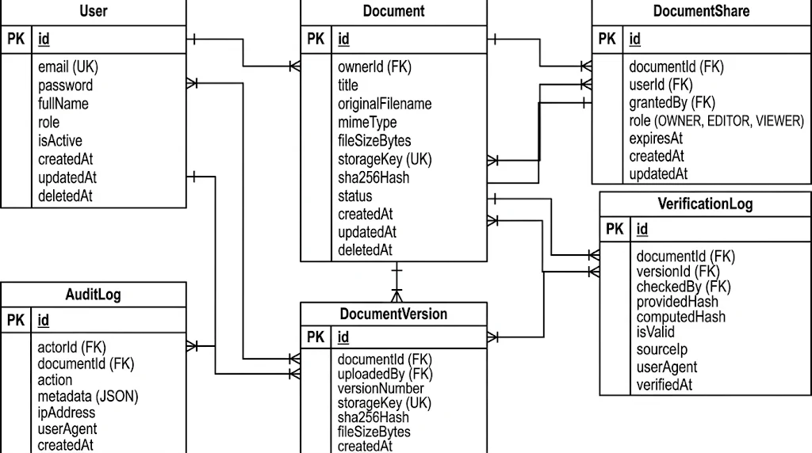

$readme = @'
# Tes XecureIt - Frontend

Frontend web application (`secure-doc-frontend`) built with **Next.js**, **React**, **TypeScript**, and **Tailwind CSS** featuring role-based access (`OWNER`, `EDITOR`, `VIEWER`) and SHA-256 document verification.

## Tech Stack
- **Framework & UI:** Next.js (`^16.4.6`), React (`^19.1.0`)
- **Language & Type Checking:** TypeScript (`^5.8.3`), `tsc --noEmit`
- **Styling:** Tailwind CSS (`^3.4.17`), PostCSS (`^8.5.23`), Autoprefixer (`^10.4.21`)
- **Container & Setup:** Docker (`Dockerfile`), `setup-frontend.cmd`

## Database Schema (ERD)


## Project Structure
```text
├── public/                 # Static assets (`ERD.webp`, images)
├── src/                    # Next.js App Router pages & components
├── .env.local.example      # Frontend environment variable template
├── Dockerfile              # Container build configuration
├── next-env.d.ts           # Next.js TypeScript environment declarations
├── package.json            # Dependencies and npm scripts
├── package-lock.json       # Locked dependency tree
├── postcss.config.js       # PostCSS configuration
├── setup-frontend.cmd      # Windows setup helper script
├── tailwind.config.ts      # Tailwind CSS configuration
└── tsconfig.json           # TypeScript compiler configuration
```

## Environment Variables
Copy `.env.local.example` to `.env.local` before running the app:

```powershell
Copy-Item .env.local.example .env.local
```

Variables in `.env.local.example`:
- `NEXT_PUBLIC_API_URL` (`http://localhost:4000/api`)
- `NEXT_PUBLIC_SSE_URL` (`http://localhost:4000/api/documents`)

## Getting Started
```bash
npm install
npm run lint
npm run dev
```

Build and run for production:
```bash
npm run build
npm start
```

Run with Docker:
```bash
docker build -t tes-xecureit-frontend .
docker run -p 3000:3000 --env-file .env.local tes-xecureit-frontend
```
'@

Set-Content -Path .\README.md -Value $readme -Encoding utf8